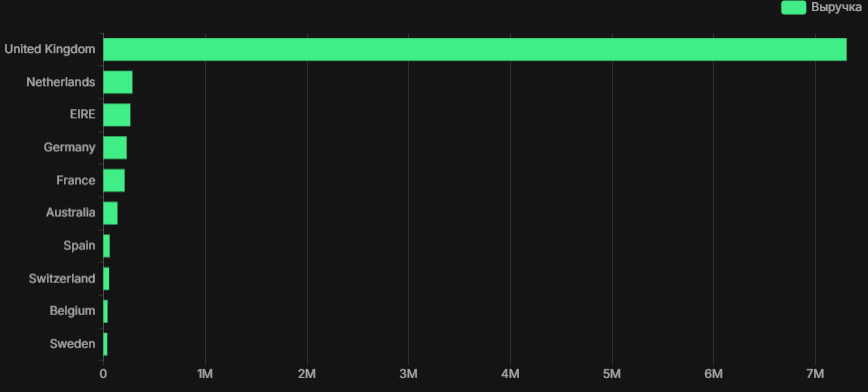
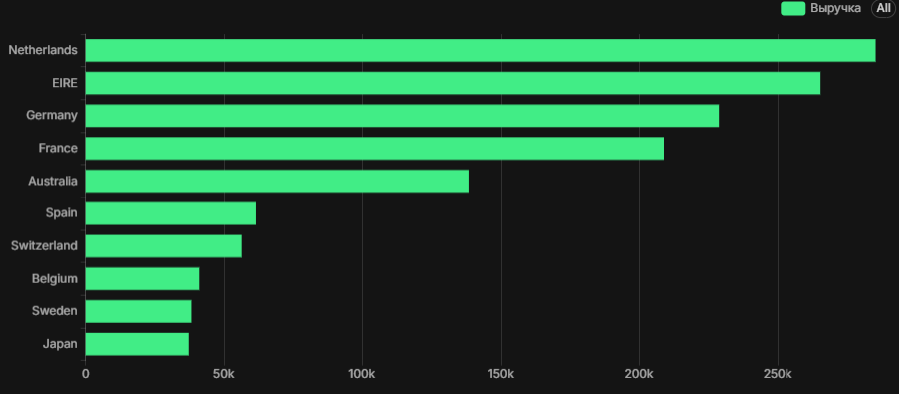

# dbt Semantic Layer (Metrics) Demo

Pet-проект по настройке семантического слоя (Semantic Layer) в dbt. 
Демонстрирует, как определять бизнес-метрики один раз в YAML, чтобы использовать их в разных BI-инструментах без дублирования SQL.

## 🎯 Бизнес-задача:
В компаниях часто одна и та же метрика (например, «Выручка») рассчитывается по-разному в разных дашбордах. Это приводит к расхождениям. Семантический слой решает эту проблему: метрика определяется в dbt, и все инструменты берут её оттуда.

## 🛠 Стек:
- **dbt-core (1.12.6):** Трансформация данных и описание семантического слоя.
- **dbt-postgres:** Адаптер для PostgreSQL.
- **MetricFlow (Semantic Layer):** Движок для расчета метрик.

## 📊 Что было сделано:
1. Создана модель `fct_sales` (витрина продаж на основе `raw_sales`).
2. Описана семантическая модель `sales` с измерениями (`order_date`, `country`) и мерами (`total_revenue`, `order_count_measure`).
3. Определены 3 метрики: `revenue` (простая), `order_count` (простая) и `average_order_value` (производная).
4. Настроена временная ось (`time_spine`) для корректной работы временных метрик.
5. Проверено, что dbt успешно распознает семантический слой (3 метрики, 1 семантическая модель).

## 💡 Выводы:
Семантический слой в dbt позволяет централизованно управлять метриками. Хотя CLI-плагин для запросов (`dbt sl`) в текущей версии недоступен, конфигурация валидна и готова к использованию через dbt Cloud или API.

## 📊 Интеграция с Superset (Визуализация метрик)

Настроено подключение Superset к базе `analytics_rfm` (через IP `10.0.2.2`). 
Создан датасет `fct_sales` и построены два графика:

1. **Выручка по странам (с UK)** — показывает абсолютного лидера (United Kingdom, ~7.5 млн).

2. **Выручка по странам (без UK)** — показывает остальные рынки (Нидерланды, Ирландия, Германия, Франция и т.д.).

## 🚀 Как запустить:
1. Установите зависимости: `pip install dbt-core dbt-postgres`
2. Выполните `dbt run` для создания таблиц.
3. Выполните `dbt parse` для проверки семантического слоя.
EOF
